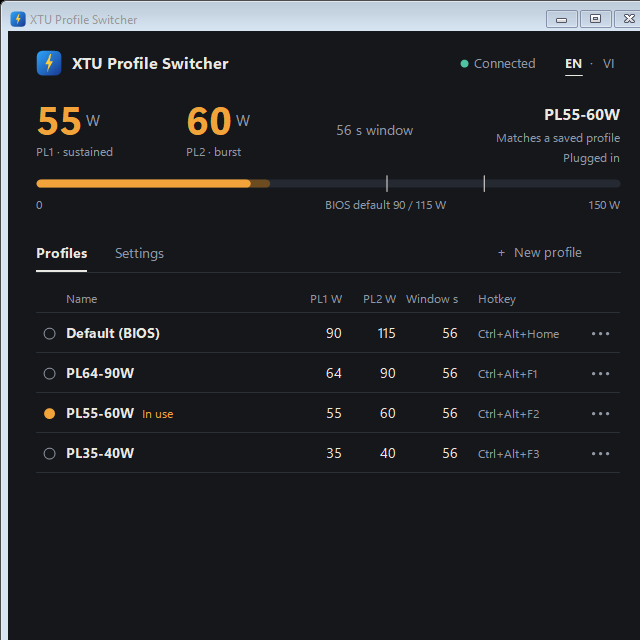

# XTU Profile Switcher

Small tray/window tool for Intel Extreme Tuning Utility (XTU) 7.14.x. Written and tested on an
Acer Predator Triton 500 SE (PT516-51s, i7-11800H, XTU 7.14.2.135, Windows 11).

> Unofficial. Not affiliated with or endorsed by Intel. It uses an internal, undocumented XTU
> interface and changes CPU power limits: use at your own risk, and test with a stress test first.
> No Intel files are included; you need XTU installed.



The window follows the Windows light/dark setting (`docs/window-light.png` shows the light one).
English is the default; the **EN · VI** switch in the top right changes the whole interface to Vietnamese
and the choice is remembered.

## What it does

- shows whether the `XTU3SERVICE` service is running and reachable
- shows the PL1 / PL2 / time-window values the CPU really has right now (read from hardware via the service)
- works out which saved XTU profile those values correspond to (XTU does not store "active profile")
- switches profiles (only PL1, PL2, PL2 enable and the time window are changed)
- global hotkeys per profile, with an on-screen pop-up showing the result
- profiles you create in the tool itself (name, PL1, PL2, time window), no need to use XTU's UI
- optional automatic switch between two profiles when the power source changes (plugged in / battery)
- optional "start with Windows", hidden in the tray

## Build

```powershell
powershell -ExecutionPolicy Bypass -File .\build.ps1
```

Uses `csc.exe` from .NET Framework 4.x. Intel's `XtuInterface.dll` / `XtuCommon.dll` are referenced from
the XTU install folder and loaded from there at run time; they are not copied here.

## Run

Double-click `XtuProfileSwitcher.exe`. It needs administrator rights (the XTU pipe only accepts admins).
Closing the window hides it to the tray; use the tray menu to switch profiles or exit. Starting it a
second time just brings the running copy to the front.

### Hotkeys

On first run these are created (`Ctrl+Alt+...`, so they differ from XTU's own `Ctrl+Shift+...`):

| Profile | Hotkey |
| --- | --- |
| PL64-90W | Ctrl+Alt+F1 |
| PL55-60W | Ctrl+Alt+F2 |
| Default (BIOS) | Ctrl+Alt+Home |

Select a profile and press **Set hotkey…** to change or clear one. Settings live in
`%LOCALAPPDATA%\XtuProfileSwitcher\settings.ini`. A hotkey needs Ctrl or Alt.

**Do not reuse the same keys as XTU's own Hotkey-Profile Pairing.** XTU listens with a global keyboard
hook (not by registering the hotkey), so both programs would react to the same key press, XTU silently.
The tool refuses a combination that XTU currently uses; you can also turn XTU's pairing off in its UI.

The pop-up is a normal top-most window, so it will not show over an exclusive-fullscreen game.

### Your own profiles

**+ New profile** creates a profile (defaults to 35 W / 40 W / 56 s) that is stored in
`settings.ini` and marked "custom" in the list. It can have a hotkey and be used in the automatic
switch like any XTU profile. Only profiles created in this tool can be deleted from it. A name that
XTU already uses wins over a tool profile with the same name.

### Automatic switch by power source

Turn on **Switch automatically by power source** and pick a profile for **When plugged in** and one for
**On battery** (or **Leave as is** to leave a case alone). The tool applies the matching profile

- at start,
- when the power source changes (power event, with a 5 s poll as a backup),
- a few seconds after the PC wakes from sleep, because power limits can fall back to firmware
  defaults around sleep.

A manual change (hotkey, tray, window) stays until the power source changes again. Changing a drop-down
only applies immediately if it is the one for the source currently in use. Both directions (plugging
in and unplugging) were tried on a real laptop.

### Start with Windows

Turn on **Start with Windows** in the window. It creates a scheduled task (`XtuProfileSwitcher`) that runs the
tool elevated 15 seconds after you log on, with `--tray`, and also on battery. Turn it off to remove it.

## Command line (no window)

```text
XtuProfileSwitcher.exe --status [--out FILE]
XtuProfileSwitcher.exe --list   [--out FILE]
XtuProfileSwitcher.exe --apply "PL55-60W" [--out FILE]
XtuProfileSwitcher.exe --startup on|off   [--out FILE]
XtuProfileSwitcher.exe --tray              # start hidden in the tray
```

`settings.ini` also takes `@lang` (`en` or `vi`) and `@theme` (`auto`, `light` or `dark`; `auto` follows
Windows). To check the look without showing a window, `--snapshot FILE.png` draws it off-screen
(`--lang vi`, `--theme light`, `--dialog hotkey|profile` and `--offline` change what is drawn).

Exit codes: 0 ok, 1 failed, 2 profile not found. A log is kept in
`%LOCALAPPDATA%\XtuProfileSwitcher\app.log`.

## Safety

- Only controls 47 (PL2), 48 (PL1), 49 (PL2 enable) and 66 (time window) are written.
- Values are checked before sending: PL1 15-120 W, PL1 <= PL2 <= 150 W, window 1-128 s, and the value
  must be in XTU's own supported list. Read-only or disabled controls are refused.
- Sequence matches XTU's own: DiscardChanges -> ProposeChange -> ApplyChanges, then a read-back.

## Notes

- Talks to an internal, unsupported XTU interface; an XTU update may break it.
- The service caches "active" values and can report 0 until told to re-read hardware, so the tool calls
  `RefreshActiveValuesFromHardwareAccess` before each read.
- Profiles are read from `C:\ProgramData\Intel\Intel Extreme Tuning Utility\Profiles.xml`.
  "Default (BIOS)" is built from the service's own default values.
- XTU saves its state when its service stops and restores it when the service starts. With Windows
  Fast Startup on, the service is neither stopped nor started on Shut down / power on, so power limits
  go back to the BIOS defaults. Turning Fast Startup off (or using Restart) avoids that.
